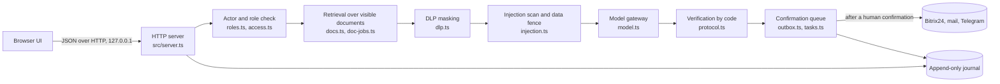

# ai photoprint

A secure AI assistant for company executives. It records a meeting, converts speech to text, builds a protocol with decisions, owners and deadlines, places the resulting tasks in Bitrix24, and works with the company's documents (package assembly, search, summary, comparison of editions). The agent only reads and prepares; every outgoing action (letter, invitation, task, publication) is confirmed by a person with the right to do so.

*Русская версия: [README.ru.md](README.ru.md)*

## 1. Project status

| | |
|---|---|
| Version | 0.9, working demo |
| Mode | **Demo mode without an external AI API.** The administration of the event stated that connecting an API is not required at this stage, so the demo runs without a language model: protocol drafts, summaries, comparisons and search are produced by deterministic code and prepared fixtures. |
| Enabling the model | One setting: `ANTHROPIC_API_KEY` in `.env`. No code changes. On the next request the gateway (`src/model.ts`) calls the Anthropic Messages API; on timeout (8 s) or error it falls back to the code path for that request. The live call path is implemented but has not been run against a real key yet. |
| External services | Bitrix24, Gmail, Telegram and Calendar are mocks with the real interface and with success, `503` and lost-reply outcomes. |
| Tests | 500 checks, `npm test`, all passing. |
| Authentication | Not implemented (demo identity). See section 12. |
| License | Source is published for viewing and review. All rights reserved; no permission to reuse is granted (`LICENSE`). |

## 2. What the system does

| Module | Function |
|---|---|
| Meetings | Calendar, invitations for employees and external guests, meetings proposed by the agent (created only after confirmation), cancellation (organiser or leadership; a meeting with a recorded protocol cannot be removed). |
| Recording | Starts only by a button press, with a visible indicator. Audio is stored in `meetings/<id>/`. Recognition runs in the browser. |
| Protocol | Topics, decisions with owners and deadlines, ideas, risks, open questions without a decision. Each item holds a quotation and transcript segment numbers; the code verifies them against the transcript. |
| Tasks | Created only from decisions that have a named owner and a deadline. Sent to leadership for confirmation by default; automatic placement is an optional setting. Idempotent. |
| Documents | Five jobs with a result window and a follow-up chat: assemble a package for a meeting, search local files, summarise a document, compare editions, find a passage with context. All run over documents the user is allowed to see. |
| Decisions queue | Everything prepared by the agent and not yet sent: invitations, letter replies, task batches. Each item shows what exactly will be sent and to whom. |
| Control | Urgent tasks, data-route map built from the journal, read-only audit trail, connection and permission settings. |
| Knowledge base | A closed task can be turned into an instruction and published by leadership. |

## 3. Technology stack

| Layer | Technology | Why |
|---|---|---|
| Runtime | Node.js 20+ | Built-in `fetch`; one runtime for server, tests and build. |
| Language | TypeScript (strict), executed by `tsx` | Types for actor, document, task and protocol structures; no separate build step. The server has no runtime dependencies. |
| HTTP | `node:http` | No framework: the whole request path (limits, headers, actor, routing) is visible in one file, `src/server.ts`. Smaller attack surface. |
| Storage | JSON and JSON Lines files, `node:fs` | No database server for a single-node demo. Atomic writes (temp file + rename), mode `0600`, directories `0700` (`src/atomic.ts`). |
| Audit | Append-only JSONL journal | Every read, refusal, confirmation and send is recorded; secrets are masked at the last step (`src/journal.ts`). |
| Identifiers | `node:crypto` | Idempotency keys and ids. |
| Retrieval (RAG) | Lexical whole-word scoring over paragraph chunks; the permission filter is applied **before** scoring | Explainable and permission-safe; no embedding service that could see closed documents. |
| Model | Anthropic Messages API (`fetch`, `anthropic-version: 2023-06-01`), default `claude-sonnet-4-5`, `max_tokens` 1024, 8 s timeout | Primary text model once a key is set. Falls back to code on any error. |
| Offline path | Extractive summary, text comparison, protocol drafts in `data/protocol-drafts`, answers in `fixtures/responses.json` | The system is fully usable without any API. |
| Speech recognition | Browser Web Speech API (`ru-RU`, `continuous`, `interimResults`), `processLocally` where the browser supports it | Speech stays on the device by default; cloud recognition only with an explicit checkbox. |
| Audio capture | `MediaRecorder` (`audio/webm;codecs=opus`, falling back to `ogg`, `mp4`) | The recording is stored with the meeting and can be played from a transcript segment. |
| Frontend | Plain HTML, JS modules and one CSS design layer (`public/theme.css`), Manrope font (Cyrillic, self-hosted) | No build step, no CDN, no third-party scripts, strict CSP. All data is written into the DOM as text, never as HTML. |
| Single-file build | `esbuild` (used only by `npm run build:html`) | Bundles the UI, the data and the server code into one HTML file; Node modules are replaced by shims in `scripts/shims`, files by an in-memory file system. |
| Tests | Plain TypeScript scripts, isolated temp state | No test framework; two suites with 500 checks. |
| Integrations (design) | Bitrix24 REST (webhook or OAuth, scopes `task`, `user`), Gmail API (`gmail.readonly`, `gmail.compose`), Telegram Bot API (webhook `secret_token`), Google Calendar API | Minimum scopes; all outgoing calls go through the confirmation queue. |

Project dependencies: one dev dependency, `tsx`. A test fails if the list grows. `esbuild` is used only for the optional single-file build.

## 4. Architecture



Every domain function receives the `Actor` (`id`, `role`, `scopes`) as its first argument; no read path bypasses it. Module map and request lifecycle: [`docs/ARCHITECTURE.md`](docs/ARCHITECTURE.md).

## 5. Why the demo works without an API

The administration of the event said an API connection is not mandatory now. For that reason:

1. All model-dependent features have a code implementation: word-overlap search with highlighted context, extractive summaries, comparison of document editions, protocol drafts built from transcripts, citation verification.
2. `src/model.ts` is a switch. With an empty `ANTHROPIC_API_KEY` it answers from the code path and fixtures and marks the answer source as `fixture`. With a key it sends a request to the Anthropic API and marks the source as `live`.
3. To connect the model: put `ANTHROPIC_API_KEY=...` into `.env` and restart. The security chain in front of the model (permission filter, DLP, injection fence) is already in place and is not changed by the switch.
4. The live request path is written but has not been exercised against a real key in this repository. Until that is done, treat "live" as implemented and untested.

## 6. Security model

Design rule: remove at least one part of the dangerous triad: access to private data, reading untrusted text, ability to send data out. Reading is read-only, sending is a human action.

| Threat | Control | Code |
|---|---|---|
| Access to data outside the user's rights | Permission filter **before** retrieval; forbidden material never reaches the model context; a closed document is indistinguishable from a missing one (404); `assertNoLeak` throws if a chunk slips through. | `access.ts`, `docs.ts` |
| Prompt injection (documents, letters, transcripts, uploads) | Outside text is data: scanned with 27 pattern groups (RU/EN) after NFKC normalisation and removal of zero-width and bidi characters; a finding marks the whole document `tainted`; text is wrapped in explicit fences; the system prompt forbids following instructions inside; findings are shown to a person, not executed. | `injection.ts` |
| Secret leakage | DLP masks API keys, tokens, JWTs, private keys, `.env` lines, passwords and Luhn-valid card numbers in queries, in model context and in the journal. Files `.env`, `id_rsa`, `*.pem`, `*.key` are refused. | `dlp.ts`, `journal.ts` |
| Trusting model output | Quotations and segment numbers are re-checked against the transcript; tasks never get invented owners or dates; the UI renders text only. | `protocol.ts` |
| Autonomous actions | Letters, invitations, tasks and publications go to the queue; only leadership confirms; idempotency keys prevent duplicates. | `outbox.ts`, `tasks.ts`, `once.ts` |
| Network exfiltration | The only outbound host in the code is the model API (asserted by a test). The server listens on `127.0.0.1`. | `model.ts`, `server.ts` |
| Browser attacks | CSP (`default-src 'self'`), `X-Frame-Options: DENY`, `Referrer-Policy: no-referrer`, `Permissions-Policy`, COOP/CORP, `nosniff`; path traversal blocked; body size limits; per-IP rate limit. | `server.ts` |
| Tampering and loss | Append-only journal; atomic writes; file modes `0600` and `0700`. | `journal.ts`, `atomic.ts` |
| Supply chain | One dev dependency, committed lockfile, no MCP servers or third-party agent skills; a test fails on new dependencies or unknown hosts. | `package.json`, `tests/` |

Policy, reporting channel and production hardening: [`SECURITY.md`](SECURITY.md).

## 7. Roles

Five roles (`src/types.ts`, `src/roles.ts`).

| Role | Documents | Confirms sends, tasks, publication | Settings | Journal | Cancels meetings |
|---|---|---|---|---|---|
| `director` | All | Yes | Yes | All users | Any future meeting |
| `deputy_tech`, `deputy_growth` | Role and scope | Yes | Yes | Own entries | Own meetings |
| `assistant` | Role and scope | No (prepares and proposes) | No | Own entries | Own meetings |
| `manager` | Own scope | No | No | Own entries | Own meetings |

A document is visible when the role is in its `allow` list and the user's scopes contain the document's `scope` (the director skips the scope check). Meeting content is visible to participants who accepted the invitation. A shared document becomes visible after the recipient accepts and can be revoked by the sender.

## 8. Data flow and storage

```
audio (browser) -> text (browser, on-device by default)
text, documents -> actor filter -> retrieval -> DLP mask -> injection fence -> model API (masked, visible fragments only)
model answer    -> code verification -> confirmation queue -> (human) -> Bitrix24 / mail / Telegram
every step      -> append-only journal (secrets masked)
```

| Data | Location |
|---|---|
| Corporate documents, rights | `data/documents/*.md`, `data/access.json` |
| Uploads and local-folder files | Memory, per user |
| Recordings, transcripts, protocols | `meetings/<id>/` |
| Tasks, shares, team, outbox, jobs, settings | `data/*.json` |
| Knowledge base | `knowledge/` |
| Audit journal | `data/trail.jsonl` |
| Secrets | `.env` (git-ignored) |

The only data that can leave the machine is masked, permission-filtered text sent to the model API (after a key is set) and, if the user ticks the box, speech audio sent by Chrome to its cloud recognition.

## 9. Integrations: demo and production

| Service | Demo (this repository) | Production design |
|---|---|---|
| Anthropic Claude API | Code ready (`src/model.ts`), key not set, fallback to code | Key in a secret manager, per-request audit without bodies |
| Bitrix24 | Mock: success, `503`, lost reply; user directory, create and close task, idempotent by key (`src/bitrix.ts`) | Inbound webhook or OAuth app, scopes `task` and `user`; same interface |
| Gmail | A letter is a document; a reply is a draft in the confirmation queue | OAuth `gmail.readonly` and `gmail.compose`; send only from the queue after confirmation |
| Telegram | `src/messenger.ts` records the intent in the journal | Bot API, webhook with `secret_token`, chat allow-list, privacy mode, no document sending |
| Google Calendar | Static `data/calendar.json` | Read through the API; create events only after confirmation |
| Speech to text | Browser Web Speech API | Self-hosted Whisper or Yandex SpeechKit / SaluteSpeech behind the same interface |

## 10. AI providers and fallback chain

| Step | Text | Speech | Status |
|---|---|---|---|
| 1 | Claude API | Browser, on-device | Claude: code ready, key not set. Browser speech: implemented |
| 2 | YandexGPT or GigaChat | Yandex SpeechKit, SaluteSpeech | Designed, not implemented |
| 3 | Self-hosted open model (Qwen, Llama, Mistral) | Self-hosted Whisper, Vosk | Designed, not implemented |
| 4 | No model: code-only search, extractive summary, comparison, protocol drafts | n/a | Implemented, default today |

Falling from step 1 to step 4 on timeout or error is implemented. Steps 2 and 3 need one `complete(prompt)` function per provider and an ordered provider list in configuration.

## 11. Run, configure, test

```bash
git clone https://github.com/d1a4y3-wq/ai-photoprint && cd ai-photoprint
npm install
npm test            # 500 checks, no network, no API key
npm start           # http://localhost:3000, binds to 127.0.0.1
npm run reset       # reset demo state
npm run build:html  # single-file demo: dist/photoprint-demo.html
```

Open as another user: `http://localhost:3000/?as=sergey` (also `ivan`, `dmitry`, `olga`).

| Variable | Default | Meaning |
|---|---|---|
| `ANTHROPIC_API_KEY` | empty | Enables the live model |
| `MODEL_NAME` | `claude-sonnet-4-5` | Model identifier |
| `BITRIX_MODE` | `mock` | Only `mock` is implemented |
| `PORT` | `3000` | Port (always on `127.0.0.1`) |
| `RATE_LIMIT_PER_MIN` | `600` | Per-IP API limit, `0` disables |
| `DEMO_TODAY` | `2026-11-11` | "Today" for the demo data |

Tests: `tests/evals.ts` (205 checks: permission filter, leak guard, injection fence, model switch, API) and `tests/demo-evals.ts` (295 checks: protocols, tasks and idempotency, Bitrix outcomes, meetings, shares, document jobs, DLP, roles, security headers, network and dependency allow-lists, confirmation queue, single-file build). Strict type checking with `tsc` passes (TypeScript is not a project dependency).

The single-file demo (`dist/photoprint-demo.html`) opens in Chrome without Node or network: the server code runs inside the page over an in-memory file system, state persists in `localStorage`, `#/reset` clears it. Microphone and Russian speech check page: [`tools/mic-check.html`](tools/mic-check.html).

## 12. Known limitations

1. **No authentication.** The user is chosen on the client (sign-in list or `?as=`). Acceptable only because the demo server listens on `127.0.0.1`. Production needs SSO (OIDC) and server sessions.
2. **Integrations are mocks.** Interfaces and failure modes are real, network calls are not.
3. **No live model run.** The Claude call path is implemented but not tested against a real key.
4. **Lexical retrieval.** Fast and permission-safe, lower recall on paraphrases than embeddings.
5. **File storage.** Single node, no cross-file transactions, no encryption at rest in the application.
6. **Pattern-based injection detection** is incomplete by nature; the design relies on structural controls (filter before retrieval, data fence, no autonomous sends, confirmation).
7. **In-memory rate limit**, per process.
8. **Provider chain** beyond "model or code" is designed only.

## 13. Path to production

- [ ] SSO (OIDC), server sessions, roles from the identity provider.
- [ ] PostgreSQL with row-level security; insert-only audit table with hash chain.
- [ ] Encryption at rest, secret manager, TLS, mTLS between services.
- [ ] Live Bitrix24, Gmail, Telegram connectors with the scopes above.
- [ ] Provider chain (steps 2 and 3) with health checks and a journal of which provider answered.
- [ ] Retention: delete raw audio after protocol approval.
- [ ] Semantic retrieval with the ACL filter inside the index query.
- [ ] CI: tests, type check, dependency audit, secret scanning, SBOM.
- [ ] Incident runbook: key rotation, journal review, removal of a poisoned document.

## 14. Repository layout

```
src/        server and domain logic
public/     HTML, JS, CSS, fonts
data/       demo documents, people, calendar, transcripts, access rules
fixtures/   prepared model answers for offline mode
tests/      two test suites
scripts/    single-file build and Node shims
tools/      microphone check
docs/       architecture; docs/ru/ has the Russian specification, design system and screens
```

## 15. Team

Built at a hackathon (Great Stone and Fotoprint) by **Karina Kartonka** and **Dasha Ananyevskaya**.
