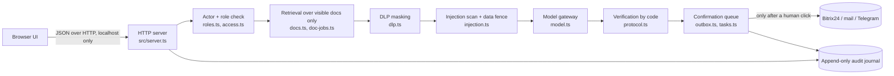

# ai photoprint: a secure AI assistant for executives

> **The agent reads and prepares. A human decides.**
> It records a meeting, turns speech into text, writes a protocol with owners and deadlines, creates the tasks in Bitrix24, and prepares documents for the next meeting. Nothing leaves the system without an explicit confirmation from a person who is allowed to give it.

*Русская версия: [README.ru.md](README.ru.md)*

| | |
|---|---|
| Status | Working demo (v0.9). All external services run as mocks with documented success and failure modes. |
| Runtime | Node.js 20+, TypeScript executed by `tsx`. One dev dependency, no framework, no database server. |
| Tests | 500 automated checks (`npm test`), all passing. |
| Languages | Interface and data are in Russian. Code comments are in Russian; this README and `SECURITY.md` are in English. |
| License | Proprietary, all rights reserved (placeholder, see `LICENSE`). |

## Contents

1. [What it does](#what-it-does)
2. [Architecture](#architecture)
3. [Security model](#security-model)
4. [Roles and access matrix](#roles-and-access-matrix)
5. [Data flow and storage](#data-flow-and-storage)
6. [Integrations: demo vs. production](#integrations-demo-vs-production)
7. [AI providers and automatic fallback](#ai-providers-and-automatic-fallback)
8. [Quick start](#quick-start)
9. [Configuration](#configuration)
10. [Testing](#testing)
11. [Single-file demo and presentation tooling](#single-file-demo)
12. [Repository layout](#repository-layout)
13. [Known limitations](#known-limitations)
14. [Path to production](#path-to-production)
15. [Team](#team)

## What it does

| Area | Capability |
|---|---|
| **Meetings** | Calendar, invitations (people and external guests), agent-proposed meetings that become real only after confirmation, cancelling meetings (organiser or leadership; meetings with a recorded protocol cannot be deleted). |
| **Recording and protocol** | Recording starts only on a button press with a visible indicator. Speech-to-text runs in the browser (on-device by default). A protocol is built: topics, decisions with owners, ideas, risks, **open questions without a decision**. Every item carries a quotation and segment numbers **verified by code**, not by the model. |
| **Tasks to Bitrix24** | Tasks come only from decisions with a named owner and a deadline. By default the agent sends them to a leader for confirmation; auto-placement is an opt-in setting. Idempotent: a retry never creates a duplicate. |
| **Documents** | Five jobs with an answer window and follow-up chat: assemble a document package for a meeting, search local files, summarise a document, compare editions, find a passage with highlighted context. Everything works only over documents the user may see. |
| **Decisions queue** | Everything the agent prepared and has not sent: invitations, replies to letters, task batches. Each shows exactly what will be sent and to whom. |
| **Control** | Urgent tasks first, a live data-route map built from the audit log, a read-only audit trail, connection and permission settings, sign-in and sign-out. |
| **Knowledge base** | A closed task can become a how-to entry, published by leadership for all employees. |

## Architecture



* **No framework.** A small HTTP server from the standard library serves the UI and a JSON API.
* **State is plain files** (`data/`), written atomically with owner-only permissions. See [Data flow and storage](#data-flow-and-storage).
* **The browser UI** is plain HTML, JS and one CSS file. There is no `innerHTML` with data; all text is set as text.
* Deeper details: [`docs/ARCHITECTURE.md`](docs/ARCHITECTURE.md).

## Security model

Design rule: **remove one of the three parts of the dangerous triad**: access to private data, reading untrusted text, and the ability to send data out. Reading is read-only; sending is always a human click.

| Threat | Control | Where |
|---|---|---|
| Reading something you may not see | Permission filter runs **before** retrieval. Forbidden material never enters the model context. A closed document is indistinguishable from a non-existent one (404, no title, no id). A final `assertNoLeak` check throws if a chunk slips through. | `access.ts`, `docs.ts` |
| Prompt injection in documents, letters, transcripts, uploads | Untrusted text is data, never instructions: (1) scanned on load, upload and import with 25+ patterns (RU/EN: reset instructions, role spoofing, exfiltration through links, shell one-liners, secret requests), after Unicode normalisation (NFKC, zero-width and bidi characters removed); (2) a document with a finding is flagged as `tainted` as a whole; (3) text is wrapped in explicit fences and the system prompt forbids obeying anything inside; (4) the finding is shown to a human and **not executed**. | `injection.ts`, `load.ts` |
| Secrets leaking into prompts, logs, or files | DLP masks API keys, tokens, JWTs, private keys, `.env` lines, passwords and Luhn-valid card numbers in queries, in model context, and **in the journal at the last step**. Files named `.env`, `id_rsa`, `*.pem`, `*.key` and files containing secrets are refused. | `dlp.ts`, `journal.ts`, `docs.ts` |
| Model output trusted blindly | Quotations and segment numbers of a protocol are re-checked against the transcript by code. Tasks never get invented owners or dates. UI renders everything as text. | `protocol.ts`, `public/` |
| Agent acting on its own | Letters, invitations, Bitrix tasks, knowledge publication: queued and sent only after confirmation by leadership. Assistants and managers cannot confirm. Repeated clicks do not duplicate (idempotency keys). | `outbox.ts`, `tasks.ts`, `once.ts` |
| Data exfiltration over the network | The only outbound host in the code is the model API (asserted by a test). The server listens on `127.0.0.1`. | `model.ts`, `server.ts` |
| Browser-side attacks | CSP (`default-src 'self'`, no inline scripts), `X-Frame-Options: DENY`, `Referrer-Policy: no-referrer`, restrictive `Permissions-Policy`, COOP/CORP, `nosniff`. Path traversal blocked (allow-listed extensions, resolved path must stay in `public/`, ids match `^[\w-]+$`). Body size limits. Per-IP rate limit on `/api/`. | `server.ts` |
| Tampering and loss | Append-only audit journal; secrets masked; state files written atomically (temp file + rename) with mode `0600`, directories `0700`. | `journal.ts`, `atomic.ts` |
| Supply chain | One dev dependency (`tsx`), lockfile committed, no MCP servers or third-party skills. A test fails if dependencies grow or an unknown host appears in code. | `package.json`, `tests/` |

Full policy, reporting channel and production hardening checklist: [`SECURITY.md`](SECURITY.md).

## Roles and access matrix

Five roles, defined in `src/types.ts`; leadership logic lives in `src/roles.ts`.

| Role | Sees documents | Confirms sends, tasks, publication | Changes settings | Sees audit journal | Cancels meetings |
|---|---|---|---|---|---|
| `director` | All | Yes | Yes | **All users** | Any future meeting |
| `deputy_tech` / `deputy_growth` | Role + scope (e.g. production, commerce) | Yes | Yes | Own entries | Own meetings |
| `assistant` | Role + scope | **No**: prepares and proposes | No | Own entries | Own meetings |
| `manager` | Own scope only | **No** | No | Own entries | Own meetings |

* A document is visible only if the role is in its `allow` list **and** the user's scopes contain the document's `scope` (the director bypasses the scope check).
* Meeting content (recording, protocol, package) is visible to participants who accepted the invitation. An invited but not yet accepted person sees only the invitation.
* Shared documents become visible to the recipient only after the recipient accepts, and can be revoked by the sender.
* Today the identity is selected by the sign-in screen or `?as=<id>` (demo only): **there is no password**. See [Known limitations](#known-limitations).

## Data flow and storage

```
audio (browser) ──► text (browser, on-device by default; Google cloud only with an explicit checkbox)
text/documents ──► actor filter ──► retrieval ──► DLP mask ──► injection fence ──► model API (only masked, visible fragments)
model answer ──► code verification ──► confirmation queue ──► (human click) ──► Bitrix24 / mail / Telegram
every step ──► append-only journal (secrets masked)
```

| Data | Where it lives | Notes |
|---|---|---|
| Corporate documents | `data/documents/*.md`, rights in `data/access.json` | Read-only for the app. |
| Users' uploads and local-folder files | Memory, per user | Never visible to another user; scanned for secrets and injections. |
| Recordings and transcripts | `meetings/<id>/` (audio, `transcript.json`, `protocol.json`) | Only participants can read; audio retention policy is a production item. |
| Tasks, shares, team, outbox, jobs, settings | `data/*.json` | Atomic writes, `0600`. |
| Knowledge base | `knowledge/*.json|md` | Published by leadership, readable by all employees. |
| Audit journal | `data/trail.jsonl` | Append-only; secrets masked. |
| Secrets | `.env` (git-ignored) | Only the model API key. Never in the UI, journal or prompts. |

Nothing is sent to a database server or a vendor. The only data that can leave the machine is the **masked, permission-filtered text** sent to the model API (and, if the user ticks the cloud-recognition box, the speech audio sent by Chrome to Google).

## Integrations: demo vs. production

| Service | In this repository | In production (design) |
|---|---|---|
| **Anthropic Claude API** | Live when `ANTHROPIC_API_KEY` is set (`src/model.ts`, 8 s timeout, falls back to deterministic code). Without a key everything runs by code, no model. | Primary text model. Key lives only in a secret manager; per-request audit without bodies. |
| **Bitrix24** | Mock with three outcomes: success, `503`, lost-reply (`src/bitrix.ts`). Directory of users, task create/close, idempotent by key. | Inbound webhook or OAuth app with scopes `task` and `user` only. Same interface, `BITRIX_MODE=live`. |
| **Gmail** | A letter is a document in the corpus; replying produces a draft that waits in the confirmation queue. | OAuth with `gmail.readonly` and `gmail.compose` (drafts). Sending only from the queue after a click. No access to other mailboxes. |
| **Telegram** | `src/messenger.ts` writes the intent to the journal. | Bot API. Webhook with `secret_token` verification, allow-list of chat ids, bot sees only messages addressed to it (privacy mode), no group reading, no documents sent. |
| **Google Calendar** | Static calendar file. | Read via API; creating meetings only after confirmation. |
| **Speech-to-text** | Browser Web Speech API. On-device by default; Google cloud only by an explicit checkbox on the recording screen. | Self-hosted Whisper, or Yandex SpeechKit / SaluteSpeech, behind the same interface. |

Secure-connection rules for mail and messengers (enforced by design, listed in `SECURITY.md`): least-privilege scopes, tokens only in a secret manager, TLS only, webhook signature checks, allow-listed senders and chats, message bodies never written to logs, DLP before anything is sent, every outgoing message previewed and confirmed by a person.

## AI providers and automatic fallback

The model gateway (`src/model.ts`) is the single place where a model is called.

| Step | Text | Speech | Status |
|---|---|---|---|
| 1 | Claude API (default `MODEL_NAME`) | On-device browser recognition | Implemented (Claude); on-device implemented |
| 2 | YandexGPT / GigaChat (reachable without VPN) | Yandex SpeechKit / SaluteSpeech | **Designed**, not implemented |
| 3 | Self-hosted open model (Qwen, Llama, Mistral) | Self-hosted Whisper / Vosk | **Designed**, not implemented |
| 4 | No model: code-only search, extractive summary, comparison, verified protocol drafts | n/a | **Implemented** (this is the default today) |

Today the gateway already degrades from 1 to 4 on timeout or error without user action. Adding steps 2 and 3 means implementing one `complete(prompt)` function per provider and an ordered list in configuration.

## Quick start

```bash
git clone <repository-url> ai-photoprint && cd ai-photoprint
npm install
npm test            # 500 checks, no network, no API key needed
npm start           # http://localhost:3000  (binds to 127.0.0.1)
```

Optional: `cp .env.example .env` and set `ANTHROPIC_API_KEY` to use a live model. Reset demo state: `npm run reset`.

To demo permissions, open the app as another user: `http://localhost:3000/?as=sergey` (manager), `?as=ivan`, `?as=dmitry`, `?as=olga`.

## Configuration

See [`.env.example`](.env.example). Main variables:

| Variable | Default | Meaning |
|---|---|---|
| `ANTHROPIC_API_KEY` | empty | Enables the live model. Never commit it. |
| `MODEL_NAME` | `claude-sonnet-4-5` | Model identifier sent to the API. |
| `BITRIX_MODE` | `mock` | Only `mock` is implemented in this repository. |
| `PORT` | `3000` | Listen port (always on `127.0.0.1`). |
| `RATE_LIMIT_PER_MIN` | `600` | Per-IP API limit; `0` disables. |
| `DEMO_TODAY` | `2026-11-11` | "Today" for the demo data. |
| `*_FILE`, `*_DIR` | under `data/` | Paths of state files, used by tests to isolate state. |

## Testing

`npm test` runs two suites (no framework, plain scripts, isolated temp state):

* `tests/evals.ts`: 205 checks of the core: permission filter, leak guard, injection fencing, model switch, API shape.
* `tests/demo-evals.ts`: 295 checks of the product: protocols, tasks and idempotency, Bitrix outcomes, meetings, shares, document jobs, DLP, roles, security headers, network and dependency allow-lists, confirmation queue, standalone build.

The code type-checks cleanly under `tsc --strict` (verified in a scratch environment; TypeScript is deliberately **not** added to the project dependencies, a test keeps the dependency list closed).

## Single-file demo

`npm run build:html` bundles the UI, fonts, data and the **server code itself** into `dist/photoprint-demo.html`. Open it in Chrome with no Node and no network: the API calls are served inside the page from an in-memory file system (state survives reloads via `localStorage`; reset with `#/reset`). Use it for presentations. A separate microphone and Russian speech check page is in [`tools/mic-check.html`](tools/mic-check.html).

## Repository layout

```
src/            server and domain logic (access, roles, injection, dlp, protocol, tasks, outbox, ...)
public/         plain HTML/JS/CSS UI, fonts, mascot
data/           demo documents, people, calendar, transcripts, access rules
fixtures/       canned model answers for offline mode
tests/          the two suites
scripts/        single-file build and Node shims for it
tools/          standalone diagnostics (microphone check)
docs/           architecture; docs/ru/ holds the Russian product spec, design system and screens
```

## Known limitations

Stated plainly, because a security story without them is not credible.

1. **No authentication.** The acting user is chosen by the client (`?as=` or the sign-in list). Anyone who can reach the server can act as anyone. This is acceptable only because the server binds to `127.0.0.1` in the demo. Production needs SSO/OIDC and server-issued sessions (see below).
2. **Integrations are mocks.** Bitrix24, Gmail, Telegram and Calendar are simulated. Interfaces and failure modes are real; the network calls are not.
3. **Retrieval is lexical**, not semantic. It is fast, explainable and permission-safe; recall on paraphrases is lower than with embeddings.
4. **File state.** Single node, no transactions across files, no encryption at rest in the app itself.
5. **Injection detection is pattern-based**; patterns reduce risk but cannot be complete. The structural defences (permission filter, data fence, no autonomous sends, human confirmation) are what the design relies on.
6. **Rate limiting is in memory** and per process.
7. **Provider fallback chain** beyond "model or code-only" is designed but not implemented.

## Path to production

- [ ] SSO (OIDC), server sessions, roles mapped from the identity provider; remove the client-chosen actor.
- [ ] Move state to PostgreSQL with row-level security; audit journal as an insert-only table with hash chaining.
- [ ] Encrypt at rest; secrets in a manager (not `.env`); TLS termination and mTLS between services.
- [ ] Live Bitrix24, Gmail and Telegram connectors with the scopes and checks listed above.
- [ ] Provider chain (steps 2 and 3) with health checks and journal of which provider answered.
- [ ] Retention: delete raw audio after protocol approval; configurable per tenant.
- [ ] Optional semantic retrieval **with ACL filter inside the index query**, never after it.
- [ ] CI: tests, type check, dependency audit, secret scanning, SBOM.
- [ ] Incident runbook (key rotation, journal review, takedown of a poisoned document).

## Team

Built at a hackathon (Great Stone and Fotoprint) by **Karina Kartonka** (3 years of design studies) and **Dasha Ananyevskaya** (1.5 years of design and development, including collaborations with an institute and large construction companies).
