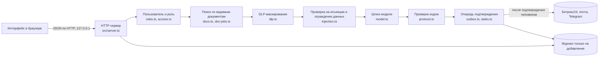

# ai photoprint

Защищённый ИИ-помощник руководителя. Записывает встречу, переводит речь в текст, строит протокол с решениями, ответственными и сроками, ставит задачи в Битрикс24 и работает с документами компании (сборка пакета к встрече, поиск, краткое содержание, сравнение редакций). Агент только читает и готовит; любое исходящее действие (письмо, приглашение, задача, публикация) подтверждает человек, у которого есть на это право.

*English version: [README.md](README.md)*

## 1. Статус проекта

| | |
|---|---|
| Версия | 0.9, рабочая демо-версия |
| Режим | **Демо без внешнего API нейросети.** Администрация мероприятия сообщила, что подключать API на этом этапе не обязательно, поэтому демо работает без языковой модели: черновики протоколов, краткое содержание, сравнение и поиск выполняет детерминированный код по заготовкам (fixtures). |
| Включение модели | Одна настройка: `ANTHROPIC_API_KEY` в `.env`. Код менять не нужно. На следующем запросе шлюз (`src/model.ts`) обращается к Anthropic Messages API; при таймауте (8 с) или ошибке на этот запрос отвечает код. Путь живого вызова написан, но на настоящем ключе ещё не запускался. |
| Внешние сервисы | Битрикс24, Gmail, Telegram и Календарь реализованы как имитации с настоящим интерфейсом и исходами «успех», `503`, «ответ потерян». |
| Тесты | 500 проверок, `npm test`, все проходят. |
| Аутентификация | Не реализована (демо-вход). См. раздел 12. |
| Лицензия | Код открыт для просмотра и проверки. Все права защищены, разрешения на повторное использование нет (`LICENSE`). |

## 2. Что делает система

| Модуль | Функция |
|---|---|
| Встречи | Календарь, приглашения сотрудников и внешних гостей, встречи, предложенные агентом (создаются только после подтверждения), отмена (организатор или руководство; встречу с записанным протоколом удалить нельзя). |
| Запись | Начинается только по нажатию кнопки, с видимым индикатором. Звук хранится в `meetings/<id>/`. Распознавание идёт в браузере. |
| Протокол | Темы, решения с ответственными и сроками, идеи, риски, открытые вопросы без решения. У каждого пункта есть цитата и номера сегментов расшифровки; код сверяет их с расшифровкой. |
| Задачи | Создаются только из решений, где указаны ответственный и срок. По умолчанию уходят руководителю на подтверждение; автоматическая постановка включается в настройках. Повторная отправка дубликат не создаёт. |
| Документы | Пять заданий с окном результата и чатом для уточнений: собрать пакет к встрече, найти в локальных файлах, кратко изложить документ, сравнить редакции, найти фрагмент с контекстом. Всё работает только по документам, которые пользователю разрешено видеть. |
| Очередь решений | Всё, что агент подготовил и не отправил: приглашения, ответы на письма, пакеты задач. Для каждого пункта показано, что именно и кому уйдёт. |
| Контроль | Срочные задачи, карта маршрута данных по журналу, журнал действий только для чтения, настройки подключений и прав. |
| База знаний | Закрытую задачу можно превратить в инструкцию; публикует руководство. |

## 3. Технологии

| Слой | Технология | Зачем |
|---|---|---|
| Среда выполнения | Node.js 20+ | Встроенный `fetch`; одна среда для сервера, тестов и сборки. |
| Язык | TypeScript (strict), запуск через `tsx` | Типы для пользователя, документа, задачи и протокола; отдельной сборки нет. У сервера нет runtime-зависимостей. |
| HTTP | `node:http` | Без фреймворка: весь путь запроса (лимиты, заголовки, пользователь, маршруты) виден в одном файле `src/server.ts`. Меньше поверхность атаки. |
| Хранилище | Файлы JSON и JSON Lines, `node:fs` | Для одного узла сервер БД не нужен. Атомарная запись (временный файл и переименование), права `0600`, каталоги `0700` (`src/atomic.ts`). |
| Аудит | Журнал JSONL только на добавление | Фиксирует каждое чтение, отказ, подтверждение и отправку; секреты маскируются на последнем шаге (`src/journal.ts`). |
| Идентификаторы | `node:crypto` | Ключи идемпотентности и id. |
| Поиск (RAG) | Лексический поиск по целым словам в абзацах; фильтр прав применяется **до** оценки | Объяснимо и безопасно по правам; нет сервиса эмбеддингов, который мог бы увидеть закрытые документы. |
| Модель | Anthropic Messages API (`fetch`, `anthropic-version: 2023-06-01`), по умолчанию `claude-sonnet-4-5`, `max_tokens` 1024, таймаут 8 с | Основная текстовая модель после установки ключа. При любой ошибке отвечает код. |
| Работа без модели | Извлекающее краткое содержание, сравнение текстов, черновики протоколов в `data/protocol-drafts`, ответы в `fixtures/responses.json` | Система полностью работает без API. |
| Распознавание речи | Web Speech API браузера (`ru-RU`, `continuous`, `interimResults`), `processLocally` там, где браузер это умеет | Речь остаётся на устройстве по умолчанию; облачное распознавание только по явной галочке. |
| Запись звука | `MediaRecorder` (`audio/webm;codecs=opus`, запасные `ogg`, `mp4`) | Запись хранится со встречей и воспроизводится с нужного сегмента расшифровки. |
| Интерфейс | Чистые HTML, JS-модули и один слой CSS (`public/theme.css`), шрифт Manrope (кириллица, локально) | Без сборки, CDN и сторонних скриптов; строгая CSP. Все данные попадают в страницу как текст, не как HTML. |
| Сборка в один файл | `esbuild` (только для `npm run build:html`) | Собирает интерфейс, данные и код сервера в один HTML; модули Node заменены заглушками в `scripts/shims`, файлы заменены файловой системой в памяти. |
| Тесты | Обычные TypeScript-скрипты, изолированное временное состояние | Без тестового фреймворка; два набора, 500 проверок. |
| Интеграции (проект) | Битрикс24 REST (вебхук или OAuth, права `task`, `user`), Gmail API (`gmail.readonly`, `gmail.compose`), Telegram Bot API (вебхук с `secret_token`), Google Calendar API | Минимальные права; все исходящие вызовы идут через очередь подтверждения. |

Зависимости проекта: одна dev-зависимость `tsx`. Тест падает, если список расширить. `esbuild` нужен только для необязательной сборки в один файл.

## 4. Архитектура



Каждая функция предметной логики первым аргументом получает `Actor` (`id`, `role`, `scopes`); ни один путь чтения его не обходит. Карта модулей и жизненный цикл запроса: [`docs/ARCHITECTURE.md`](docs/ARCHITECTURE.md).

## 5. Почему демо работает без API

Администрация мероприятия сообщила, что подключение API сейчас не обязательно. Поэтому:

1. Для всех функций, зависящих от модели, есть реализация в коде: поиск по совпадению слов с выделением контекста, извлекающее краткое содержание, сравнение редакций, черновики протоколов из расшифровок, проверка цитат.
2. `src/model.ts` работает как переключатель. При пустом `ANTHROPIC_API_KEY` отвечает код и заготовки, источник ответа помечается `fixture`. При наличии ключа запрос уходит в Anthropic API, источник помечается `live`.
3. Чтобы подключить модель: добавить `ANTHROPIC_API_KEY=...` в `.env` и перезапустить. Защитная цепочка перед моделью (фильтр прав, DLP, ограждение от инъекций) уже работает и от переключения не меняется.
4. Путь живого запроса написан, но на настоящем ключе в этом репозитории не запускался. Пока это не сделано, режим `live` считать реализованным и непроверенным.

## 6. Модель безопасности

Принцип: убрать хотя бы одну часть опасной тройки: доступ к приватным данным, чтение недоверенного текста, возможность отправить данные наружу. Чтение только на чтение, отправку выполняет человек.

| Угроза | Защита | Код |
|---|---|---|
| Доступ к данным вне прав пользователя | Фильтр прав **до** поиска; закрытое не попадает в контекст модели; закрытый документ неотличим от несуществующего (404); `assertNoLeak` выбрасывает ошибку, если фрагмент проскочил. | `access.ts`, `docs.ts` |
| Prompt injection (документы, письма, расшифровки, загрузки) | Чужой текст считается данными: проверка 27 группами шаблонов (RU/EN) после нормализации NFKC и удаления невидимых символов и символов bidi; находка помечает весь документ как `tainted`; текст оборачивается в явные ограждения; системный промпт запрещает выполнять инструкции внутри; находки показываются человеку и не исполняются. | `injection.ts` |
| Утечка секретов | DLP маскирует ключи API, токены, JWT, приватные ключи, строки `.env`, пароли и номера карт (проверка Луна) в запросах, в контексте модели и в журнале. Файлы `.env`, `id_rsa`, `*.pem`, `*.key` отклоняются. | `dlp.ts`, `journal.ts` |
| Слепое доверие ответу модели | Цитаты и номера сегментов перепроверяются по расшифровке; в задачи не попадают выдуманные ответственные и сроки; интерфейс выводит только текст. | `protocol.ts` |
| Самостоятельные действия агента | Письма, приглашения, задачи, публикации попадают в очередь; подтверждает только руководство; ключи идемпотентности исключают дубли. | `outbox.ts`, `tasks.ts`, `once.ts` |
| Утечка по сети | Единственный внешний хост в коде: API модели (проверяется тестом). Сервер слушает `127.0.0.1`. | `model.ts`, `server.ts` |
| Атаки на браузер | CSP (`default-src 'self'`), `X-Frame-Options: DENY`, `Referrer-Policy: no-referrer`, `Permissions-Policy`, COOP/CORP, `nosniff`; блокировка выхода за каталог; лимиты размера тела; лимит запросов на IP. | `server.ts` |
| Подмена и потеря данных | Журнал только на добавление; атомарная запись; права `0600` и `0700`. | `journal.ts`, `atomic.ts` |
| Цепочка поставок | Одна dev-зависимость, lock-файл в репозитории, нет MCP-серверов и сторонних навыков агента; тест падает при новых зависимостях и неизвестных хостах. | `package.json`, `tests/` |

Политика, канал сообщений об уязвимостях и список мер для промышленной эксплуатации: [`SECURITY.md`](SECURITY.md).

## 7. Роли

Пять ролей (`src/types.ts`, `src/roles.ts`).

| Роль | Документы | Подтверждает отправки, задачи, публикацию | Настройки | Журнал | Отмена встреч |
|---|---|---|---|---|---|
| `director` | Все | Да | Да | Всех пользователей | Любая будущая встреча |
| `deputy_tech`, `deputy_growth` | По роли и областям | Да | Да | Свои записи | Свои встречи |
| `assistant` | По роли и областям | Нет (готовит и предлагает) | Нет | Свои записи | Свои встречи |
| `manager` | Своя область | Нет | Нет | Свои записи | Свои встречи |

Документ виден, если роль есть в его списке `allow`, а области пользователя содержат `scope` документа (директор проверку области пропускает). Содержимое встречи видят участники, принявшие приглашение. Документ, которым поделились, становится виден после принятия получателем; отправитель может отозвать доступ.

## 8. Движение данных и хранение

```
звук (браузер) -> текст (браузер, на устройстве по умолчанию)
текст, документы -> фильтр по пользователю -> поиск -> DLP-маска -> ограждение от инъекций -> API модели (только замаскированные видимые фрагменты)
ответ модели     -> проверка кодом -> очередь подтверждения -> (человек) -> Битрикс24 / почта / Telegram
каждый шаг       -> журнал только на добавление (секреты замаскированы)
```

| Данные | Где лежат |
|---|---|
| Документы компании, права | `data/documents/*.md`, `data/access.json` |
| Загрузки и файлы локальной папки | Память, отдельно для каждого пользователя |
| Записи, расшифровки, протоколы | `meetings/<id>/` |
| Задачи, доступы, команда, очередь, задания, настройки | `data/*.json` |
| База знаний | `knowledge/` |
| Журнал действий | `data/trail.jsonl` |
| Секреты | `.env` (в `.gitignore`) |

Наружу могут уйти только замаскированный текст, отфильтрованный по правам, в API модели (после установки ключа) и, если пользователь поставил галочку, звук речи, который Chrome отправляет в своё облачное распознавание.

## 9. Интеграции: демо и промышленная схема

| Сервис | Демо (этот репозиторий) | Проект для промышленной эксплуатации |
|---|---|---|
| Anthropic Claude API | Код готов (`src/model.ts`), ключ не задан, отвечает код | Ключ в менеджере секретов, аудит каждого запроса без тел |
| Битрикс24 | Имитация: успех, `503`, потерянный ответ; справочник сотрудников, создание и закрытие задачи, идемпотентность по ключу (`src/bitrix.ts`) | Входящий вебхук или OAuth-приложение, права `task` и `user`; тот же интерфейс |
| Gmail | Письмо — это документ; ответ — черновик в очереди подтверждения | OAuth `gmail.readonly` и `gmail.compose`; отправка только из очереди после подтверждения |
| Telegram | `src/messenger.ts` записывает намерение в журнал | Bot API, вебхук с `secret_token`, список разрешённых чатов, режим приватности, без отправки документов |
| Google Календарь | Статический `data/calendar.json` | Чтение через API; создание событий только после подтверждения |
| Речь в текст | Web Speech API браузера | Собственный Whisper или Yandex SpeechKit / SaluteSpeech за тем же интерфейсом |

## 10. Поставщики ИИ и цепочка резервов

| Шаг | Текст | Речь | Статус |
|---|---|---|---|
| 1 | Claude API | Браузер, на устройстве | Claude: код готов, ключа нет. Речь в браузере: реализована |
| 2 | YandexGPT или GigaChat | Yandex SpeechKit, SaluteSpeech | Спроектировано, не реализовано |
| 3 | Собственная открытая модель (Qwen, Llama, Mistral) | Собственный Whisper, Vosk | Спроектировано, не реализовано |
| 4 | Без модели: поиск, извлекающее краткое содержание, сравнение, черновики протоколов кодом | нет | Реализовано, сейчас по умолчанию |

Переход с шага 1 на шаг 4 при таймауте или ошибке реализован. Для шагов 2 и 3 нужна одна функция `complete(prompt)` на поставщика и упорядоченный список поставщиков в конфигурации.

## 11. Запуск, настройка, тесты

```bash
git clone https://github.com/d1a4y3-wq/ai-photoprint && cd ai-photoprint
npm install
npm test            # 500 проверок, без сети и ключа
npm start           # http://localhost:3000, слушает 127.0.0.1
npm run reset       # сбросить состояние демо
npm run build:html  # демо одним файлом: dist/photoprint-demo.html
```

Открыть под другим пользователем: `http://localhost:3000/?as=sergey` (также `ivan`, `dmitry`, `olga`).

| Переменная | По умолчанию | Значение |
|---|---|---|
| `ANTHROPIC_API_KEY` | пусто | Включает живую модель |
| `MODEL_NAME` | `claude-sonnet-4-5` | Идентификатор модели |
| `BITRIX_MODE` | `mock` | Реализована только имитация |
| `PORT` | `3000` | Порт (всегда на `127.0.0.1`) |
| `RATE_LIMIT_PER_MIN` | `600` | Лимит запросов API на IP, `0` отключает |
| `DEMO_TODAY` | `2026-11-11` | «Сегодня» для демо-данных |

Тесты: `tests/evals.ts` (205 проверок: фильтр прав, защита от утечки, ограждение от инъекций, переключатель модели, API) и `tests/demo-evals.ts` (295 проверок: протоколы, задачи и идемпотентность, исходы Битрикса, встречи, доступы, задания по документам, DLP, роли, заголовки безопасности, списки разрешённых хостов и зависимостей, очередь подтверждения, сборка в один файл). Строгая проверка типов `tsc` проходит (TypeScript в зависимости проекта не входит).

Демо одним файлом (`dist/photoprint-demo.html`) открывается в Chrome без Node и сети: код сервера работает внутри страницы поверх файловой системы в памяти, состояние хранится в `localStorage`, `#/reset` его сбрасывает. Страница проверки микрофона и русской речи: [`tools/mic-check.html`](tools/mic-check.html).

## 12. Известные ограничения

1. **Нет аутентификации.** Пользователя выбирает клиент (список входа или `?as=`). Допустимо только потому, что демо-сервер слушает `127.0.0.1`. Для промышленной эксплуатации нужны SSO (OIDC) и серверные сессии.
2. **Интеграции имитируются.** Интерфейсы и исходы сбоев настоящие, сетевые вызовы нет.
3. **Живая модель не запускалась.** Путь вызова Claude написан, но на настоящем ключе не проверен.
4. **Лексический поиск.** Быстрый и безопасный по правам, но на перефразировках полнота ниже, чем у эмбеддингов.
5. **Файловое хранилище.** Один узел, нет транзакций между файлами, нет шифрования на диске средствами приложения.
6. **Обнаружение инъекций по шаблонам** неполно по своей природе; опора на структурные меры (фильтр до поиска, ограждение данных, нет самостоятельных отправок, подтверждение).
7. **Лимит запросов в памяти**, отдельно для каждого процесса.
8. **Цепочка поставщиков** кроме «модель или код» только спроектирована.

## 13. Путь к промышленной эксплуатации

- [ ] SSO (OIDC), серверные сессии, роли из провайдера идентификации.
- [ ] PostgreSQL с политиками на уровне строк; таблица журнала только на добавление с цепочкой хэшей.
- [ ] Шифрование на диске, менеджер секретов, TLS, mTLS между сервисами.
- [ ] Рабочие коннекторы Битрикс24, Gmail, Telegram с перечисленными правами.
- [ ] Цепочка поставщиков (шаги 2 и 3) с проверкой доступности и записью в журнал, кто ответил.
- [ ] Срок хранения: удалять исходный звук после утверждения протокола.
- [ ] Семантический поиск с фильтром прав внутри запроса к индексу.
- [ ] CI: тесты, проверка типов, аудит зависимостей, поиск секретов, SBOM.
- [ ] Регламент на инциденты: смена ключей, разбор журнала, удаление отравленного документа.

## 14. Структура репозитория

```
src/        сервер и предметная логика
public/     HTML, JS, CSS, шрифты
data/       демо-документы, люди, календарь, расшифровки, правила доступа
fixtures/   заготовки ответов модели для работы без API
tests/      два набора тестов
scripts/    сборка в один файл и заглушки Node
tools/      проверка микрофона
docs/       архитектура; docs/ru/ содержит русские спецификацию, дизайн-систему и экраны
```

## 15. Команда

Создано на хакатоне (Great Stone и Fotoprint): **Карина Картонка** и **Даша Ананьевская**.
